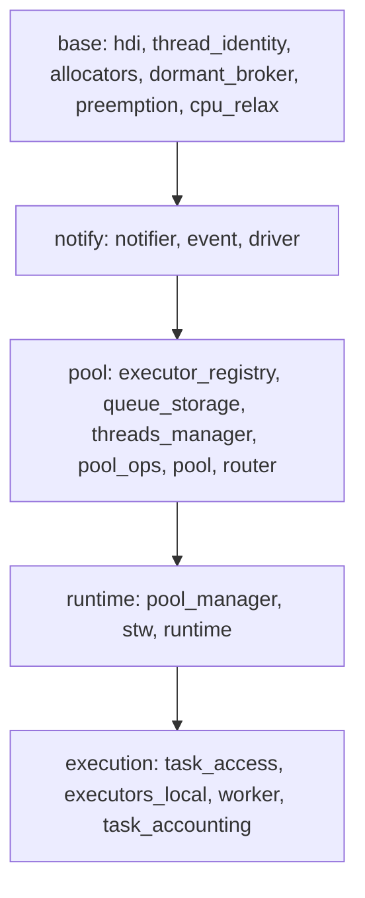

# Scheduler Core

This page is the map of `src/tasks/core`. It answers three questions a newcomer asks
first: where does a given piece of behaviour live, in what order should the files be
read, and which rules must stay true when changing them.

## Which directory answers which question

`src/tasks/core` is split by the question a file answers, not by the type of the thing
it declares.

| Directory | Answers |
|---|---|
| [`core/runtime/`](../src/tasks/core/runtime/runtime.hpp:28) | "Where is the process-wide state?" — `scheduler_runtime`, the `glob` singleton, the pool slot table, the allocator caches, stop-the-world, the thread-name plumbing |
| [`core/pool/`](../src/tasks/core/pool/pool.hpp:59) | "Where is a pool and its lifecycle?" — storage types, the ops table, the slot table, spawning and retiring workers, dormant sharing, the balancer, routing a task into a pool |
| [`core/execution/`](../src/tasks/core/execution/executors_local.hpp:24) | "Where does one task run on one thread?" — the per-thread executor state, the entry points, the three run modes, context switching, accounting, preemption |
| [`core/notify/`](../src/tasks/core/notify/pool_wake.hpp:1) | "Where does something get woken up?" — events, the floating driver, timer-wheel handoff, pool-level wake helpers |

`src/tasks/classes/` holds the user-facing classes (`task`, `worker_pool` methods,
synchronization primitives). `src/tasks/util/` holds standalone utilities with no
scheduler policy in them (deques, the timing wheel, stacks, `cpu_relax`, the hill
climber). Everything under `src/tasks` reaches the core through the umbrella
[`_internal.hpp`](../src/tasks/_internal.hpp:1), whose include list is grouped by the
same four directories.

## Reading order

1. [`include/fast_task/task/scheduler.hpp`](../include/fast_task/task/scheduler.hpp:19)
   — the public surface: options, stats, `worker_pool`, and the two storage buffers.
2. [`core/pool/pool.hpp`](../src/tasks/core/pool/pool.hpp:59) — `worker_pool_storage`,
   the templated `configured_worker_pool_storage<Q, I, B, IsGlobal, Scale>` and the
   size assertions that keep it inside the public buffer.
3. [`core/pool/pool_ops.hpp`](../src/tasks/core/pool/pool_ops.hpp:21) — the ops table.
   Every policy decision is a function pointer installed here once, by the storage
   constructor, so the rest of the code calls `pool.ops.queue.*` without knowing `Q`.
4. [`core/execution/executors_local.hpp`](../src/tasks/core/execution/executors_local.hpp:24)
   — what a worker thread owns: its deque, its registry slot, its batch counters.
5. [`classes/task/worker_context.cpp`](../src/tasks/classes/task/worker_context.cpp:324)
   — the run loop: `poll_all` (serve until shutdown) and `poll_drained` (hand control
   back when the queue empties).
6. [`core/runtime/runtime.hpp`](../src/tasks/core/runtime/runtime.hpp:28) — the
   singletons the loop touches: `no_tasks`, `timing`, `shutdown`, the driver, the pools.

## Include direction

Top depends on bottom, never the reverse:

[`scripts/check_layers.sh`](../scripts/check_layers.sh) enforces this mechanically: a
file may include its own layer or any lower one. Two files carry a rank that differs
from their directory, because ranking them by directory would claim dependencies that
do not exist:

- [`execution/preemption.hpp`](../src/tasks/core/execution/preemption.hpp:1) sits in
  `execution/` but depends on the base layer only.
- [`notify/pool_wake.hpp`](../src/tasks/core/notify/pool_wake.hpp:1) sits in `notify/`
  but wakes pools through `glob`, which makes it a runtime-layer file.

## The four template parameters

A pool is a compile-time configuration. The storage constructor installs an ops table
once, and nothing re-checks the policy at runtime.

| Parameter | Values today | Decides |
|---|---|---|
| `Q` (`queue_policy`) | `work_stealing_lifo`, `priority_fifo` | which queues exist in `queue_storage<Q>` and how a task is enqueued and dequeued |
| `I` (`idle_policy`) | `wait`, `busy_spin` | how a worker with no work waits |
| `B` (`worker_balancer`) | `none`, `hill_climb` | whether the pool owns a balance window and a climber at all |
| `Scale` (`worker_scale`) | `single_worker`, `multi_worker` | whether stealing is compiled in |

`IsGlobal` is the fourth storage axis: it selects `executor_registry<1024>` held by the
pool manager versus a `binded_executor_registry` owned by the pool.

## Invariants

These hold today. A change that breaks one is a bug, not a refactor.

- **A task is booked in exactly one pool.** [`task_mark_created`](../src/tasks/core/execution/task_accounting.hpp:28)
  increments that pool's `executing_tasks` when the task enters the pool, and
  [`release_executing_tasks`](../src/tasks/core/execution/task_accounting.hpp:50)
  decrements it exactly once — on completion, on a batch flush, or when the pool drops
  the task. Underflow aborts in debug builds.
- **Only the last release notifies.** `release_executing_tasks` calls
  `notify_no_tasks_waiters()` when the counter reaches zero, and nowhere else does.
- **Accounting travels with the task.** A task changes pools only through
  `retarget_task`, which moves the booking in the same step.
- **Storage is placement-new'd, never allocated.** A pool lives inside a buffer of
  `worker_pool_storage_size` (8192 bytes), next to its public handle; the
  `static_assert`s in [`pool.hpp`](../src/tasks/core/pool/pool.hpp:116) keep every
  instantiation inside it. The storage may be reconstructed only while `pool_pristine`
  is true.
- **The ops table is written once.** It is filled by the storage constructor and read
  afterwards; it is not a place to mutate policy at runtime.
- **No pool stores a registry pointer.** `uses_global_registry` picks between
  `glob.pools.registry` and the pool's own `registry_data` with `if constexpr`, so the
  global pool's 8 KB buffer holds no registry pointer at all.
- **A `none` balancer costs nothing.** `pool_balancer<none>` is an empty type: no
  window, no climber, no branch in the wake path.
- **Shutdown is two flags, not one.** `glob.shutdown.requested` stops new timed waits
  and drains the wheel; `glob.shutdown.executors_down` tells workers to leave. The
  transitions are taken under `glob.no_tasks.guard`, the same mutex the no-tasks
  notifier and both shutdown waits use.
- **A worker serves one pool at a time.** `executors_local::owner_pool` is the only
  pool a worker books completions against; a foreign completion takes the slow path.

## Extending the core

**A new queue policy.** Add the enumerator in
[`scheduler.hpp`](../include/fast_task/task/scheduler.hpp:34), specialise
`queue_storage<Q>` in [`queue_storage.hpp`](../src/tasks/core/pool/queue_storage.hpp:23),
implement the `enqueue`/`requeue`/`dequeue_bulk`/`has_*`/`steal`/`drain`/`pending`
family in [`pool_ops.cpp`](../src/tasks/core/pool/pool_ops.cpp:70), and extend the
`if constexpr` chain in `make_ops` and the dispatch in `make_pool_storage_for`. Add a
size assertion in [`pool.hpp`](../src/tasks/core/pool/pool.hpp:116) and a row to
`tests/scheduler/test_pool_policies.cpp`.

**A new idle policy.** Implement a wait strategy in `pool_ops.cpp` (see
`wait_until_with` and `busy_spin_until`), wire it in `make_ops`, and widen
`make_pool_storage_for`.

**A new balancer.** Specialise
[`pool_balancer<B>`](../src/tasks/core/pool/pool_balancer.hpp:27) so the type owns
exactly the state the policy needs, implement `arm`, `run` and `samples` in
[`pool_balancer.cpp`](../src/tasks/core/pool/pool_balancer.cpp:1), and add the value to
`make_pool_storage_for`. The ops table already routes `arm`/`run`/`samples`, so no call
site changes.

**A new wake source.** Add it to the owning pool's `scheduler_event` set and route it
through [`pool_wake.hpp`](../src/tasks/core/notify/pool_wake.hpp:18), which takes the
storage rather than a loose `(event, index)` pair.

## What is deliberately not here

- The notification system behind a pool's queue is still a fixed `scheduler_event`;
  choosing it per storage type is
  [deferred](../plans/incomplete-todos.md#2-deferred--notification-system-selection).
- `executing_tasks` is still a per-pool counter updated per task. Replacing it with a
  quiescence check is parked in
  [`deferred-executing-tasks.md`](../plans/deferred-executing-tasks.md).

## Related pages

- [Architecture Overview](architecture.md) — the scheduler, timer and preemption model.
- [Scheduler](scheduler.md) — the public scheduler API.
- [Debugging](debugging.md) — how to inspect a running scheduler.
